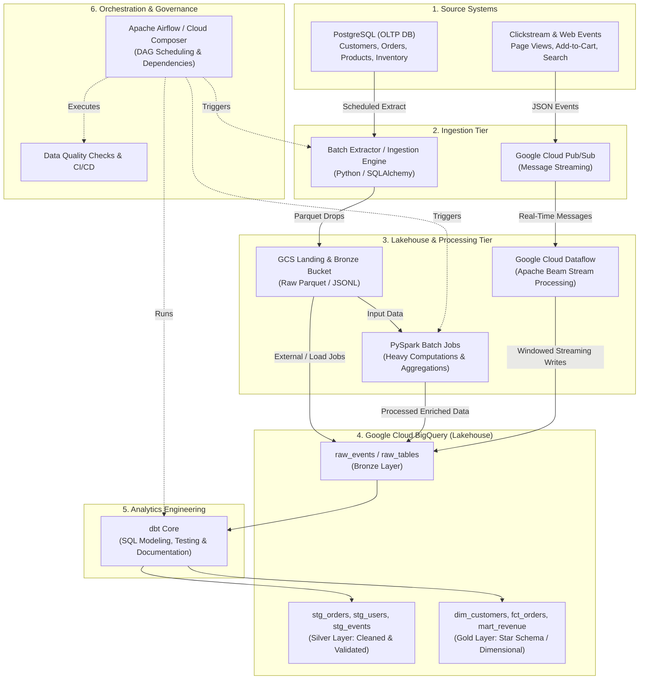

# RetailPulse Data Engineering Platform

[](https://cloud.google.com/)
[](https://www.python.org/)
[](https://www.postgresql.org/)
[](https://cloud.google.com/bigquery)
[](https://www.getdbt.com/)
[](https://airflow.apache.org/)

---

## 1. Project Overview & Objective

**RetailPulse Data Engineering Platform** is an enterprise-grade, end-to-end e-commerce data platform architected on Google Cloud Platform (GCP) and modern open-source technologies.

In modern retail and e-commerce enterprises, critical business decisions depend on two distinct data streams:
1. **Transactional Data (Batch / CDC)**: Relational tables capturing customers, orders, order items, products, inventory, and payment transactions.
2. **Behavioral Data (Streaming)**: High-throughput real-time events capturing user clickstreams, search queries, cart additions, and checkout drop-offs.

The objective of **RetailPulse** is to unify these disparate transactional and behavioral data assets into an automated, highly reliable, and scalable Data Lakehouse architecture. The platform reliably ingests, cleanses, models, and exposes analytics-ready datasets for executive dashboards, customer segmentation, inventory forecasting, and real-time operational alerts.

---

## 2. High-Level Architecture

The platform adopts a unified **Lambda / Medallion Architecture** that processes both batch transactional data and real-time streaming event data into Google Cloud Storage and BigQuery, modeled using dbt, and orchestrated with Apache Airflow.



### Architectural Layers

| Layer | Component | Description |
| :--- | :--- | :--- |
| **Ingestion (Batch)** | Python / SQLAlchemy / GCS Client | Extracts snapshots and incremental tables from PostgreSQL into GCS landing zones. |
| **Ingestion (Streaming)** | Google Cloud Pub/Sub | Scalable, low-latency ingestion bus for clickstream events and real-time transaction webhooks. |
| **Stream Processing** | Google Cloud Dataflow (Apache Beam) | Real-time deduplication, schema validation, session windowing, and dead-letter queue (DLQ) routing into BigQuery. |
| **Big Data Batch Processing** | PySpark (Cloud Dataproc) | Large-scale historical backfills, complex joins, and feature aggregations across massive historical datasets. |
| **Storage & Lakehouse** | GCS & BigQuery | Cloud object storage for raw immutable data lake retention and BigQuery for analytical compute and storage. |
| **Transformation (Medallion)** | dbt (Data Build Tool) | Declarative SQL-based transformation from Raw (Bronze) to Staged/Normalized (Silver) to Dimensional Marts (Gold). |
| **Workflow Orchestration** | Apache Airflow / Google Cloud Composer | Automated DAG scheduling, pipeline backfilling, SLA monitoring, and alerting. |

---

## 3. Technology Stack

| Domain | Technology | Purpose & Rationale |
| :--- | :--- | :--- |
| **Programming Language** | **Python 3.10+** | Industry standard for data pipelines, Apache Beam, PySpark, scripting, and orchestration. |
| **Source Database** | **PostgreSQL** | Realistic ACID-compliant transactional store representing the e-commerce OLTP backend. |
| **Cloud Platform** | **Google Cloud Platform (GCP)** | Enterprise cloud ecosystem providing managed data analytics services. |
| **Object Storage (Data Lake)** | **Google Cloud Storage (GCS)** | Durable, cost-effective object storage acting as the raw landing zone (Bronze layer). |
| **Data Warehouse** | **Google Cloud BigQuery** | Serverless, highly scalable columnar analytical data warehouse. |
| **Stream Processing** | **Google Cloud Pub/Sub & Dataflow** | Managed message broker paired with Apache Beam for scalable event stream ingestion. |
| **Batch Compute** | **PySpark / Dataproc** | Distributed processing framework for batch ETL and heavy computation. |
| **Data Modeling & Quality** | **dbt Core** | Version-controlled SQL transformations, automated data testing, and lineage documentation. |
| **Orchestration** | **Apache Airflow / Cloud Composer** | DAG-based workflow orchestration, dependency management, and monitoring. |
| **Containerization** | **Docker & Docker Compose** | Reproducible local execution environments for PostgreSQL, Airflow, and utility services. |
| **Configuration & Secrets** | **Python Dotenv & Secret Manager** | Secure, decoupled environment configuration preventing secret leakage. |

---

## 4. Repository Layout

```text
retailpulse-data-platform/
├── .env.example               # Template environment configuration (placeholders only)
├── .gitignore                  # Security-first ignore file for Python, GCP, Docker, dbt
├── README.md                   # Project overview, architecture, and roadmap
├── data/                       # Local data directory for testing & raw samples
│   ├── raw/                    # Local raw data storage (ignored by git)
│   └── processed/              # Local processed outputs (ignored by git)
├── docs/                       # Architectural diagrams, specifications, data contracts
├── infrastructure/             # Docker Compose, Terraform, and cloud setup scripts
├── ingestion/                  # Ingestion scripts (PostgreSQL extractors, Pub/Sub publishers)
├── sql/                        # Source database initialization & DDL schemas
└── tests/                      # Unit, integration, and data contract tests
```

---

## 5. Planned Development Roadmap

The platform will be built systematically across 7 progressive phases:

```text
Phase 1: Environment & Repository Setup (Current)
    └── Directory layout, .gitignore, .env.example, architecture docs

Phase 2: Source Modeling & Transactional Ingestion
    └── PostgreSQL schema & sample data generator (orders, users, products)
    └── Python-based batch extractor loading into GCS bronze bucket

Phase 3: Real-Time Event Streaming
    └── Clickstream event simulation & publishing to Cloud Pub/Sub
    └── Apache Beam / Cloud Dataflow pipeline for stream cleansing & BigQuery streaming insertion

Phase 4: Big Data Batch Processing with PySpark
    └── PySpark jobs for historical joins, aggregations, and customer metrics
    └── Partitioning, bucketing, and optimization strategies

Phase 5: Lakehouse Modeling with dbt
    └── Bronze / Raw layer staging models
    └── Silver layer: sanitized entities, surrogate keys, data cleansing
    └── Gold layer: Dimensional modeling (Fact Orders, Dim Customer, Dim Product, Marts)
    └── dbt tests (uniqueness, referential integrity, accepted values) and documentation

Phase 6: Workflow Orchestration with Apache Airflow
    └── End-to-end DAGs managing batch ingestion -> PySpark -> dbt runs -> data validation
    └── Failure handling, retry policies, Slack/email notifications

Phase 7: End-to-End Testing, CI/CD & Production Readiness
    └── Pytest suite for extractors and transforms
    └── GitHub Actions CI pipeline for linting, dbt compile, and test coverage
```

---

## 6. Getting Started & Configuration

### Prerequisites
- **Python**: Version 3.10 or higher
- **Git**: Version 2.20+
- **Docker & Docker Compose**: For local containerized services
- **Google Cloud SDK (`gcloud`)**: Authenticated to your target GCP project

### Local Environment Setup

1. **Clone the repository**:
   ```bash
   git clone <repository-url>
   cd retailpulse-data-platform
   ```

2. **Configure Environment Variables**:
   Copy the example environment file and fill in your target configuration:
   ```bash
   cp .env.example .env
   ```
   > **Note:** Never commit `.env` or any GCP service account keys to source control.

---

## 7. Security and Governance Standards

- **Zero-Secret Commits**: All credentials, keys, and tokens must remain in environment variables or cloud secret stores.
- **Principle of Least Privilege**: IAM roles must be tightly scoped per pipeline component (e.g., separate service accounts for Ingestion, Dataflow, and Airflow).
- **Data Quality & Testing**: Every transformation layer must enforce assertions on primary keys, nullability, and foreign key relationships via automated tests.
# RetailPulse

